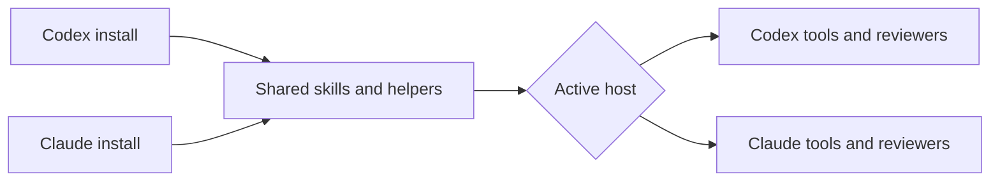

# P1 Codex support

Signed off: 2026-10-20

## Summary

Install and run all four skills in Codex without Claude Code. Keep one shared set of skills and support both hosts.

## What you said

- "Let's make this installable for codex users as well" (chat) → Add a documented Codex installation.
- "Install and run without Claude (Recommended)" (scope answer) → All four skills must work with Codex alone.

## Done when

- **P1-S1 Install**: A user adds this repository as a Codex marketplace, installs its plugin, and discovers all four skills with their supporting files. The README gives copyable session prompts and terminal commands for install and updates, plus invocation instructions.
- **P1-S2 Build**: A conversational request to build something can select the build skill. Codex can follow setup and build, resolve bundled helpers, delegate work and review a committed change without invoking Claude. Review failures and changes to the reviewed head or working tree prevent publishing success.
- **P1-S3 Inspect**: Architecture review and retro use Codex tools and available Codex session evidence. A missing session record is reported without inventing findings.
- **P1-S4 Both hosts**: Claude installation and execution remain supported. Tests cover Codex operation with Claude absent, explicit Codex selection with Claude present, and helper failure paths.

## Solution

Add Codex plugin and marketplace metadata pointing to the shared skills. Document native installation and the existing symlink option. Add concise host instructions for helper paths, invocation, delegation and session records. Make the review helper support Codex-only execution while retaining its evidence and failure checks.

A separate copy of each skill is excluded to keep the workflows consistent.

### Your directives

- "Install and run without Claude (Recommended)" (scope answer).
- "Never invoke Claude helpers." (working agreements).

## Out of scope

Windows-native shell helpers, a Codex automatic update hook, and changes to the engineering workflow beyond host compatibility.

## Validation

Run the repository suite and shell syntax checks. Install the local plugin in an isolated Codex home and inspect its installed files and skill discovery. Exercise helper success and failure with controlled CLI stubs; report live model or UI evidence separately.
