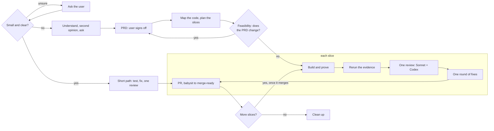

# Build

The user owns the problem, the taste and the veto. You own everything else. Anything the code, the docs, an experiment, the web or a second opinion can answer, you answer yourself.

What can't be fixed later is building the wrong thing. So every interaction with the user serves one purpose: making sure your picture of the problem and the solution matches theirs. Treat them as a busy CPTO: stop for them only when a decision is truly theirs, lead with what they must decide, and link everything else.

Small slices make a single review enough. Each slice is small enough to review whole, and its builder proves it works before anyone reviews it.



If a `.worktrees/p<n>-*` worktree already holds a PRD for this, resume at the first step that isn't done. Settled things stay settled.

**The manifest.** Read `.agents/project.md` before anything else. It names this repo's paths, tracker, commands, isolated stack and workflow, described in the `setup` skill's [manifest.md](../setup/manifest.md). If it's missing, run `/setup` first. Below, *Plans*, *Verify*, *the base branch* and the like mean that line of the manifest.

`$S` below is this skill's directory: `S="${CLAUDE_SKILL_DIR}"`.

**Codes carry names.** Wherever a person reads it (the PRD, the PR, comments, messages to the user), every plan, slice, scenario or finding code carries its short name: "P92 (reusable rockets) S3 (retractable landing legs)", never "P92 S3".

**Progress notes.** At each change of stage, tell the user in one line what finished and what's next, with no question attached.

**A second opinion** is Codex when `codex` is installed (`codex.sh consult`), and otherwise one fresh Claude subagent told to poke holes. Either way it's one run per question, never a loop.

## 0. Size it first

Read first: the manifest's *Routing* file and every doc it names for the area, the ticket with its comments and linked issues if there is one, and enough of the code to size it. Something that looks like an obvious fix may be deliberate, and the docs say why.

**The full workflow** (§1 onward) is required if any of these hold:

- It adds or changes behaviour in a way that neither the request nor what you just read settles.
- There is more than one reasonable approach, and the user would care which.
- It touches auth, data or migrations, infrastructure, or CI.
- It spans more than one component, or goes past roughly 150 changed lines.
- The ticket's "done" needs pinning down, or the docs or ticket contradict the request.

**The short path** is for everything else: a bug fix restoring documented behaviour, a copy tweak, a change the request specifies completely, edits to skills, docs or config. When in doubt, ask the user in one question, your recommendation first.

1. Work in its own worktree (`<Worktrees>/<slug>`, branch `fix/<slug>` or `chore/<slug>`, with the ticket ID after the prefix when there is one). Run *Install*, and add `.build/` to `$(git rev-parse --git-common-dir)/info/exclude`.
2. For code: a failing test that shows the problem, then the fix, then a commit. Prose-only changes have nothing to test.
3. Update the reference or data-flow doc if the behaviour it describes changed, and run *Verify* plus each *Extra check* whose condition the change meets.
4. Review it once and fix as §5 says. If a blocker needs a design decision, it wasn't a short-path change: say so and switch.
5. Ship as in §6, with proof only when something visible changed.

## 1. Understand

Read before you ask: the *Routing* file and every document it names for this work, the *Plans index*, and the PRDs in other worktrees (`git worktree list`). Another plan may already own part of this. To answer a question about the code, send an `Explore` subagent rather than reading files yourself.

**A ticket, if there is one** (a key matching the *Key pattern*, a link, or the branch name): read it, its comments and linked issues. If there's no ticket, don't invent one or ask for one.

Get evidence, not opinions. Reproduce the problem, measure it, and find out what the code really does. When a choice turns on a fact, run a cheap spike in the scratchpad. Compare real alternatives, including the smallest change that could work. If the request names a solution and not its purpose, find out what it buys.

**Second opinion, then ask.** Write `.build/consult.md` (in the scratchpad until the worktree exists) with your understanding, the alternatives and your draft questions, and ask what's wrong with the approach, whether its design holds up, which questions the code or docs already answer, and what you missed. Run it in the background:

```bash
"$S/codex.sh" consult "$PWD" .build/consult.md .build/consult-answer.md
```

Whatever it settled, you settle. Ask the user only what only they can say: a goal, a trade-off between their goals, money, taste, or a conflict with something they decided. Play your understanding back and ask in batches, your recommended answer first, until what you say back is what they had in mind.

A technical directive from the user ("use X") beats a standard. If it contradicts one, say in a sentence what the standard protects, then follow the directive and record it as a standards change. Every directive goes into the PRD under **Your directives**, quoted: it's settled, and reviewers don't reopen it.

## 2. The PRD

**Worktree.** Number the plan one above the highest plan number anywhere: *Plans* on the base branch, in every worktree, and on every branch (`git log --all --name-only --format= -- '<Plans>' | grep -ioE '(^|/)p[0-9]+'`). Create `<Worktrees>/p<n>-<slug>` on branch `feat/p<n>-<slug>-a` (slice A) from an up-to-date base branch. With a ticket, its ID goes after the number: `p19-proj-12-<slug>`. Copy the root `.env` in if there is one, run *Install*, and add `.build/` to `$(git rev-parse --git-common-dir)/info/exclude`.

**The PRD** is the what and why, for the user: `<Plans>p<n>-<slug>/prd.md`, rendered to `prd.html` and published for comments, as [`prd-format.md`](prd-format.md) describes. Under the title `# P<n> <Name>`: the ticket link when there is one, `PRD: <artifact url>`, and the sign-off line. Then:

- `## Summary`: what and why, in two or three sentences.
- `## What you said`: the user's words, quoted verbatim with their source, each followed by `→` and your reading. A decision you only have secondhand is a paraphrase, labelled as one.
- `## Where I might be wrong`: the assumptions that would change what gets built, each with **If not:** and what would change.
- `## Done when`: the scenarios, `**P<n>-S<k> <short name>**: <observable behaviour>`, failure paths included. They're the goals, the test names and the proof checklist. Always write the full id, so one grep finds PRD row, test, proof script and commit.
- `## Solution`: how it works, drawn where a drawing is clearer, with the rejected alternative in one line. Then `### Your directives`, quoted.
- `## Out of scope`, and `## Open questions` when there are any.

Add the index entry and commit the PRD folder. It ships with slice A.

**Sign-off.** The one stop for the user: send the PRD's link and ask them to approve or correct it. Once they approve, write `Signed off: <date>` under the title and commit. The PRD changes after that only with the user.

## 3. Map and plan

**The code map.** A documentarian subagent, with [`research.md`](research.md) as its prompt, maps the code into `.build/research.md`. You plan from it, and every builder starts from it.

**The plan** is for agents: `.build/plan.md`. It names each slice's scope and goal, not its code.

```markdown
# P<n> <Name>: plan

## Decisions
| Choice | Rejected | Why |

## Standards changes
The exact new wording for each file under *Standards*, as blockquotes. Only when there are some.

## Slice A: <short name>
- Serves: P<n>-S1 (<name>), P<n>-S2 (<name>)
- Proof: how each scenario is shown working (UI, API, CLI), or why only tests can show it

### Step 1: <short name>
- Depends on: none, or the steps it needs
- Scope: the files and areas it may change
- Done when: what's true when it's finished

## Changed during implementation
One line per departure, added as it happens.
```

**Slices.** A slice is the smallest set of steps after which the base branch still works and could ship. It cuts through every layer its scenarios need (data, API, UI, tests), serves one to three scenarios, and fits one builder's fresh context. Split one that grows past three scenarios or about 400 changed lines. Order them so the first proves the riskiest part. A wide mechanical change (a rename across the codebase) goes expand, migrate in batches, contract, each its own slice. When nothing short of the whole feature can ship, it's one slice, and the plan says why.

Steps within a slice that share no dependency and no scope can run in parallel. When they'd share types, interfaces or a migration, a first step lands those.

**Feasibility.** Put the PRD, the map and the plan to a second opinion: what won't work, what the plan misses, which slice is mis-cut. Settle what it raises yourself. Stop for the user only when a `Done when` scenario would be added, removed or reworded, or a directive broken: update the PRD with them and sign it off again.

## 4. Build and prove

For each slice in turn. You orchestrate, and fresh Opus 5.5 builders write the code, as [`orchestrate.md`](orchestrate.md) says. Every builder follows the *Routing* file, the *Standards* and these rules:

1. **Red.** Write the tests for the scenarios the step serves, named by scenario id, and watch them fail for the right reason. Include the failure modes that apply (bad input, permissions, concurrency, a dependency refusing or hanging), and for anything crossing a trust boundary, the abuse case.
2. **Green.** Write the least code that passes, following the standards.
3. **Prove it.** When the step completes a scenario its user can reach, start an isolated stack (the manifest's *Isolated stack* with `N=<plan number>_<step number>` and a free port), do the scenario as its user would, and check the result where it lands: the rows, the job, the log lines. Save that as `.build/proof/<scenario id>-<name>.<ext>` in the feature worktree, a script that reads the stack's address from the environment (`BASE_URL`), so anyone can rerun it. It writes what it captured to `.build/proof/out/`: the request and response or the rows as text, and for UI, screenshots on desktop and phone, with a clip where an interaction matters. Then stop the stack and run its *Cleanup*. Passing tests aren't proof.
4. **Commit**, naming the scenario: `P19-S3: refuse a second vote while one is in flight`.

**Check against the PRD as you go.** When reality disagrees with the plan, decide by the PRD's goals and add a line under `## Changed during implementation`. Escalate only when stuck, or when a `Done when` scenario or a directive would have to change.

**Every bug gets a regression test**, wherever it turns up: a builder, a reviewer, CI or the user. A failing test that reproduces it, then the fix, then a commit naming the bug.

**Docs move with the code.** A behaviour change isn't finished until its doc under *Reference docs* or *Data flows* agrees with it. Apply the plan's standards changes in the commit that first relies on them.

**What this change won't fix goes to the backlog.** With a tracker (*Kind* isn't `none`), open a ticket for each problem found and left unfixed, after searching for one that already covers it: what's wrong and the evidence, where, who it hits, a proposed fix, and the PR where it was found. Only open it. Without a tracker, list them in your hand-off.

**Rerun the evidence.** Once every step of the slice has landed, start the stack (`N=<plan number>`) on the slice's head and rerun every proof script in `.build/proof/`, earlier slices' included. A script that fails, or captures something other than its scenario says, goes back to a builder as a bug. Don't review a slice whose evidence doesn't rerun.

## 5. Review, once

Each slice gets one review, then one round of fixes, then ships. The prompt is [`review.md`](review.md); change it there, not in a brief. Write `.build/review/<slice>/brief.md`: what the slice does, the paths of the PRD, the plan and `.build/proof/`, which scenarios it serves, and the user's directives and other deliberate choices. Then run both in the background, on the same commit, and wait for both:

```bash
"$S/codex.sh" review "$WT" "$WT/.build/review/<slice>/brief.md" "$WT/.build/review/<slice>"
"$S/pass.sh" "$WT" "$WT/.build/review/<slice>/brief.md" "$WT/.build/review/<slice>"
```

Without `codex`, Sonnet reviews alone. Each prints its findings and its blocker count.

**One round of fixes.** One subagent handles every finding from `codex.json` and `sonnet.json`:

- **Blockers (P1, P2)**: a confirmed one gets a regression test, then the fix, then a commit naming the finding. A fix is finished when everything that names or relies on what it changed agrees. A misread one: cite the line that disproves it. One that's by design: cite the PRD, plan or standard. Evidence that doesn't prove its scenario gets better evidence, not a dismissal.
- **P3s and cuts**: take them when small and in a file the slice touches. The rest go to the backlog (§4).
- A fix that would change agreed behaviour (not restore it) goes to the user.

Then run *Verify*, rerun the evidence, and ship. No second review runs: fixes are small, each has its own test, and the evidence reran on them.

## 6. Ship

Each slice ships on its own, and the next slice starts from the base branch once this one merges. If the manifest's *Landing* is `local merge`, run "Nothing ships red", then land it as [local-merge.md](local-merge.md) says, in place of everything from **The record** on.

**Nothing ships red.** Merge the up-to-date base branch in (don't rebase a pushed branch). On the result, run *Verify* and the *Extra checks* that apply, with the stack up for any that need it, and check the PRD page is current: `node "$S/render-prd.mjs" --tokens <Tokens> --check <Plans>`. Every PR check must be green too. A failure is a bug (§4), not a retry.

**The record.** Write `.build/proof/README.md`, the proof page: the commit it was captured at, then each screenshot, GIF or captured output under the scenario it proves (id and name), with one line on what it shows. Convert clips with the manifest's *ffmpeg* in place of `ffmpeg` when it has one:

```bash
ffmpeg -y -i in.webm -vf "fps=10,scale=960:-1:flags=lanczos,split[a][b];[a]palettegen[p];[b][p]paletteuse" out.gif
```

Beside it, `review.md`: the findings and what happened to each. Publish them with `plan.md` and `research.md` to the *Proof media branch*. It prints the page's URL.

```bash
"$S/publish-media.sh" p<n>-<slug>-<slice> .build/proof/README.md .build/proof/review.md .build/plan.md .build/research.md <each captured file>
```

**The PR**, for a busy CPTO who reads it in under a minute. Push and open it with `gh`. The title follows the repository's commit style, with the ticket ID when there is one, and names the slice: `feat(PROJ-12): export answers as Markdown (2/3: the download button)`. The body, with nothing about how it was built:

- **What**: two lines, and the slices still to come in one line.
- **Why**: two lines, with the ticket link and the PRD's link.
- **Evidence**: two to four key screenshots, clips or captured outputs, embedded, each under one line naming the scenario. Then anything the user must decide or do, and one line linking the proof page.
- The last line: the *PR footer*, when the manifest has one.

Make every link and image absolute: an image is `https://github.com/<repo>/blob/<Proof media branch>/p<n>-<slug>-<slice>/<file>?raw=true`. Check them with `gh api repos/<repo>/pulls/<n> -H "Accept: application/vnd.github.full+json" -q .body_html`. To edit the body later, `gh api -X PATCH repos/<repo>/pulls/<n> -F body=@<file>`.

**Babysit it until it's merge-ready**: every check green at the head, every review thread settled, and the branch containing the current base branch without conflicts. Agents never merge. Run the watches in the background and act on each notification; fixes go to subagents.

- **A check fails**: a bug (§4). A check that fails and then passes with no change is flaky, and that's a bug too.
- **A review comment arrives**, from a person or a bot: check it against the code. Right: regression test, fix, commit, reply with the commit. Wrong: reply with the line, PRD or standard that shows why. Changes agreed behaviour: ask the user. Resolve a bot's thread once the fix is green or the dismissal cites evidence; leave a person's thread for them.
- **A requested bot review hasn't arrived** after about 30 minutes: carry on without it, and say so in your hand-off.
- **The base branch moves on**: merge it in and rerun "Nothing ships red".
- **After any code change**: rerun the evidence, and update the PR body and the proof page to show the head.

**Hand it to the user** once it's merge-ready: the link, then what needs them first, then one line each on what it does and what the proof showed. Stop the stack (the PIDs in `.build/pids`). Pick the PR up again when the user comments or asks. When it merges, start the next slice: `git switch -c feat/p<n>-<slug>-<next> <base branch>` in the feature worktree after updating the base branch, and go back to §4. If the build was harder than it should have been, suggest `/retro` in one line.

**After the last slice merges**, if the user asks you to clean up: check each PR is `MERGED` at the head you pushed (`gh pr view <n> --json state,headRefOid`). Kill anything left in `.build/pids` and run the *Isolated stack*'s *Cleanup* with each `N` used. Fast-forward the base branch, `git worktree remove` the worktree and any builder worktrees, and delete the local branches (`-D` is fine for these exact verified branches, since squash merges don't keep ancestry) and any remote branch GitHub left.
