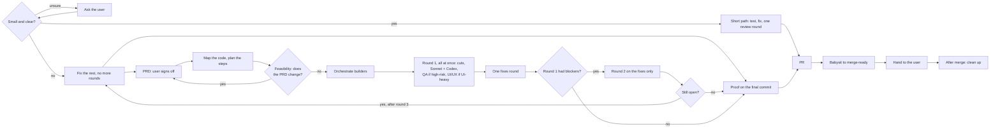

# Build

The user owns the problem, the taste and the veto. You own everything else. Anything the code, the docs, an experiment, the web or a second opinion can answer, you answer yourself.

What can't be fixed later is building the wrong thing. So every interaction with the user serves one purpose: making sure your picture of the problem and the solution matches theirs. Treat them as a busy CPTO: stop for them only when a decision is truly theirs, lead with what they must decide, and link everything else.



If a `.worktrees/p<n>-*` worktree already holds a PRD for this, resume at the first step that isn't done. Settled things stay settled.

**The manifest.** Read `.agents/project.md` before anything else. It names this repo's paths, tracker, commands, isolated stack and workflow, described in the `setup` skill's [manifest.md](../setup/manifest.md). If it's missing, run `/setup` first. Below, *Plans*, *Verify*, *the base branch* and the like mean that line of the manifest.

`$S` below is this skill's directory: `S="${CLAUDE_SKILL_DIR}"`.

**Codes carry names.** Wherever a person reads it (the PRD, the PR, comments, messages to the user), every plan, scenario, step or finding code carries its short name: "P92 (reusable rockets) S3 (retractable landing legs)", never "P92 S3".

**Progress notes.** At each change of stage, tell the user in one line what finished and what's next, with no question attached.

**A second opinion** is Codex when `codex` is installed (`codex.sh consult`), and otherwise one fresh Claude subagent told to poke holes. Either way it's one run per question, never a loop.

## 0. Size it first

The full workflow is for work where a wrong picture is expensive. Most changes aren't. Decide which path this is, but read first: the manifest's *Routing* file and every doc it names for the area, the ticket with its comments and linked issues if there is one, and enough of the code to size it. Something that looks like an obvious fix may be deliberate, and the docs say why.

**The full workflow** (§1 onward) is required if any of these hold. They win over everything below.

- It adds or changes behaviour in a way that neither the request nor what you just read settles. Placement, wording, defaults, edge cases and failure handling count only when the request, the docs and the existing code leave them open.
- There is more than one reasonable approach, and the user would care which.
- It touches auth, data or migrations, infrastructure, or CI.
- It spans more than one component (backend, a UI, the worker, infra), or goes past roughly 150 changed lines.
- The ticket's "done" needs pinning down, or the docs or ticket contradict the request.

**The short path** is for everything else. Typical cases: a bug fix restoring the behaviour the docs describe, a copy tweak, a change the request specifies completely, and edits to skills, docs or config.

**When in doubt, ask.** Put it to the user in one question, with your recommendation first and one line on why. Once they choose, that's settled. If the short path meets one of the triggers above, stop and say so, then switch.

The short path:

1. Work on a branch in its own worktree (`<Worktrees>/<slug>`, branch `fix/<slug>` or `chore/<slug>`), with the ticket ID after the prefix when there is one. There's no PRD or plan. Run *Install*, and add `.build/` to `$(git rev-parse --git-common-dir)/info/exclude` if it isn't already there. The review writes to `.build/`, and the scripts refuse a dirty tree.
2. For code: a failing test that shows the problem, then the fix, then a commit. For a bug, the test is its regression test. Prose-only changes (docs, skills) have nothing to test.
3. Update the reference or data-flow doc if the behaviour it describes changed.
4. Run *Verify*, plus each of the *Extra checks* whose condition the change meets.
5. Run one review round (§5, Sonnet and Codex, same brief) and handle its findings as §5 says. If a blocker needs a design decision, it wasn't a short-path change, so switch to the full workflow.
6. Ship as in §6, with proof only when something visible changed.

## 1. Understand

Read before you ask: the *Routing* file and every document it names for this work, the *Plans index*, and the PRDs in other worktrees (`git worktree list`). Another plan may already own part of this. To answer a question about the code, send an `Explore` subagent rather than reading files yourself.

**A ticket, if there is one.** The user may name a ticket matching the *Key pattern*, paste its link, or be on a branch whose name carries one. If so, read it (the tracker's connector or CLI, or the *Ticket URL*), including its comments and linked issues. It's part of the problem statement. If there's no ticket, don't invent one or ask for one.

Get evidence, not opinions. Reproduce the problem, measure it, and find out what the code really does. When a choice turns on a fact, run a cheap spike in the scratchpad. When the right approach isn't obvious, compare real alternatives, including the smallest change that could work. If the request names a solution ("add a cache") and the context doesn't say what it's for, find out what it buys, so you solve the need.

**Second opinion, then ask.** Write `.build/consult.md` (in the scratchpad until the worktree exists) with your understanding, the alternatives and your draft questions. Ask the second opinion what's wrong with the approach, whether its design holds up (depth, locality, seams, fit with the codebase, the next change), which questions the code or docs already answer, and what you missed. Run it in the background and wait for the notification.

```bash
"$S/codex.sh" consult "$PWD" .build/consult.md .build/consult-answer.md
```

Whatever it settled, you settle. What's left are the things only the user can say: a goal, a trade-off between their goals, money, taste, or a conflict with something they decided. Play your understanding back and ask those, in batches with your recommended answer first (`AskUserQuestion` in Claude Code), until what you say back is what they had in mind. If nothing is left, don't ask.

A technical directive from the user ("use X") beats a standard. If it contradicts one, say in a sentence what the standard protects, then follow the directive and record it as a standards change. Every directive goes into the PRD under **Your directives**, quoted: it's settled, and reviewers don't reopen it.

If the change is big, or the code it touches resists it, consider suggesting `/improve-architecture` pointed at this work ("how could the code make this change easy?") before planning.

## 2. The PRD

**Worktree.** Number the plan one above the highest plan number anywhere: check *Plans* on the base branch, in every worktree, and on every branch (`git log --all --name-only --format= -- '<Plans>' | grep -ioE '(^|/)p[0-9]+'`). Create `<Worktrees>/p<n>-<slug>` on branch `feat/p<n>-<slug>` from an up-to-date base branch. With a ticket, its ID goes after the number everywhere: `p19-proj-12-<slug>`, `feat/p19-PROJ-12-<slug>`. Copy the root `.env` into it if there is one, run *Install*, and add `.build/` to `$(git rev-parse --git-common-dir)/info/exclude`.

**The PRD** is the what and why, for the user: `<Plans>p<n>-<slug>/prd.md`, rendered to `prd.html` beside it and published for comments, as [`prd-format.md`](prd-format.md) describes. Under the title `# P<n> <Name>`: `Ticket: [PROJ-12](<Ticket URL>)` when there's a ticket, `PRD: <artifact url>`, and the sign-off line. Then:

- `## Summary`: what and why, in two or three sentences.
- `## What you said`: the user's words, quoted verbatim with their source, each followed by `→` and your reading of them. Never put quotation marks around words they didn't write: a decision you only have secondhand is a paraphrase, labelled as one.
- `## Where I might be wrong`: the assumptions that would change what gets built, each with **If not:** and what would change. Delete them as the user confirms them.
- `## Done when`: the scenarios, `**P<n>-S<k> <short name>**: <observable behaviour>`, failure paths included. They're the build's goals, the test names and the proof checklist. Always write the full id, so one grep finds PRD row, test and commit.
- `## Solution`: how it works, drawn wherever a drawing is clearer than words, with the rejected alternative in one line. Then `### Your directives`: the user's technical decisions and the ticket's constraints, quoted.
- `## Out of scope`, and `## Open questions` when there are any.

Add the index entry and commit the PRD folder as the worktree's first commit.

**Sign-off.** This is the one stop for the user. Send them the PRD's link and ask: approve it, or correct it. Comments on the page are handled as `prd-format.md` says. Once they approve, write `Signed off: <date>` under the title and commit. The PRD changes after that only with the user (§3).

## 3. Research and plan

**The code map.** Send a documentarian subagent, with [`research.md`](research.md) as its prompt, to map the code into `.build/research.md`: where everything relevant lives, with file, line and symbol, judging nothing. You plan from the map, and every builder starts from it.

**The plan** is for agents, not the user: `.build/plan.md`. Detailed enough that a builder knows its scope and its goal, but not the code itself: builders decide on the fly.

```markdown
# P<n> <Name>: plan

## Decisions
| Choice | Rejected | Why |
Feature-local invariants, when they matter. Skip anything the standards or the code already decide.

## Standards changes
The exact new wording for each file under *Standards*, as blockquotes. Only when there are some.

## Review
Which of QA and UI/UX run (§5), and why. The cuts pass and the code review always do.

## Steps
### Step 1: <short name>
- Depends on: none, or the steps it needs
- Scope: the files and areas it may change
- Serves: P<n>-S1 (<name>), P<n>-S2 (<name>)
- Done when: what's true when it's finished

## Changed during implementation
One line per departure, added as it happens.
```

Steps that share no dependency and no scope can run in parallel. When parallel steps would share types, interfaces or a migration, make a first step that lands them, and let the others depend on it. The plan and the map stay uncommitted in `.build/`, and §6 publishes them with the proof.

**Feasibility.** Put the PRD, the map and the plan to a second opinion: what won't work, what the plan misses, which step is mis-scoped. Settle what it raises yourself. Stop for the user only when a `Done when` scenario would be added, removed or reworded, or a directive broken: update the PRD with them, and sign it off again. Otherwise, build.

## 4. Build

You orchestrate, and fresh Opus 5.5 builders write the code, as [`orchestrate.md`](orchestrate.md) says. Every builder follows the *Routing* file, the *Standards* and these rules:

1. **Red.** Write the tests for what the step serves and watch them fail for the right reason. Include the failure modes that apply (bad input, concurrency, cancellation, a dependency refusing or hanging), and for anything crossing a trust boundary, the abuse case.
2. **Green.** Write the least code that passes, following the standards.
3. **Prove it runs.** When the step completes a scenario its user can reach (UI, API or CLI), start an isolated stack for it: the manifest's *Isolated stack* with `N=<plan number>_<step number>` and a free port. Do the scenario as its user would, and check the result where it lands (the rows, the job, the log lines). Save the happy path as a script under `.build/qa/proof/` in the feature worktree, named by the scenario's id and name, that saves its key screenshots. It reads the stack's URL and anything else stack-specific from the environment (`BASE_URL`, say), so it reruns against any stack. Before you report, stop the stack and run the *Isolated stack*'s *Cleanup* with the same `N`. Passing tests aren't this check.
4. **Commit**, naming the scenario: `P19-S3: refuse a second vote while one is in flight`.

**Check against the PRD as you go.** When what you're building stops making sense against the PRD's goals, say so. When reality disagrees with the plan, decide by the PRD's goals and add a line under `## Changed during implementation`. Escalate only when you're stuck, or when a `Done when` scenario or a directive would have to change.

**Every bug gets a regression test**, wherever it turns up: a builder, QA, a reviewer, CI or the user. Write a failing test that reproduces it, then fix it, then commit naming the bug. Look for the same defect elsewhere.

**What this change won't fix goes to the backlog.** When the manifest names a tracker (*Kind* isn't `none`), open a ticket in its backlog for each problem found and left unfixed: a P3 not fixed, a bug that predates the change, a gap QA or a reviewer found outside the PRD. Search the tracker first; if a ticket already covers it, comment there instead. Write it for someone who wasn't here: what's wrong and the evidence, where (files, routes, commands), who it hits, a proposed fix, when it's done, and the PR where it was found. Open it with the tracker's connector or CLI, and only open it: don't plan, prioritise or start it. Without a tracker, these go in your hand-off to the user instead.

**Docs move with the code.** A behaviour change isn't finished until its doc under *Reference docs* or *Data flows* agrees with it, in present tense. Apply the plan's standards changes in the commit that first relies on them.

## 5. Review

Each stage runs on a commit, and the scripts refuse a dirty tree. The prompts live in this skill, so change them there, not in a brief: [`review-rules.md`](review-rules.md) for the read-only passes, [`review-cuts.md`](review-cuts.md) for the simplifier, [`review-qa.md`](review-qa.md) and [`review-ux.md`](review-ux.md) for the running change, and [`review-code.md`](review-code.md) for the code review. Each script adds the target itself: the whole diff from the merge base to the commit it reads. Every brief holds what the change does, the PRD's and plan's paths, the user's directives and other deliberate choices, and from round 2, every earlier blocker with what changed for it (and in which commit) or your reason for dismissing it.

**Who reviews.** Every change gets the cuts pass and the code review. Two more run only when the change earns them. Decide which when you plan, write it in the plan, and say it in your progress note:

- **QA** when the change is high-risk: auth, credentials or permissions; data that can be lost or corrupted (migrations, deletes, imports, sync); concurrency (locks, queues, retries); or the user asks for it.
- **UI/UX** when a new screen or flow is a main part of the change.

**Round 1: everything at once, on one commit.** First, every `Done when` scenario its user can reach needs a builder's proof script in `.build/qa/proof/`. One that only became runnable once chains merged goes to a builder to prove now. Then write the briefs with scope `full`, start every pass in the background, and wait for all of them.

- **Cuts.** Claude Sonnet 5.5 assumes the change is bloated and reports cuts and cleanups:

  ```bash
  "$S/pass.sh" cuts "$WT" "$WT/.build/review/brief-cuts.md" "$WT/.build/review"
  ```

- **Code review.** Claude Sonnet 5.5 and Codex `gpt-6.1-sol`, both at `xhigh` effort in round 1 and `high` in the rounds that check fixes, review the whole diff in parallel, on the same prompt and brief: bugs, security, and departures from the architecture and the design standards. Each round is fresh sessions on one commit. Without `codex`, Sonnet reviews alone. Whichever finishes last prints the round's blocker count.

  ```bash
  "$S/codex.sh" review "$WT" "$WT/.build/review/brief-<n>.md" "$WT/.build/review" <n>
  "$S/pass.sh" review "$WT" "$WT/.build/review/brief-<n>.md" "$WT/.build/review" <n>
  ```

- **QA**, when it runs. Start the worktree's own stack, with its own database, so it can't touch the user's processes, data or job queue: run the manifest's *Isolated stack* recipe with `N=<plan number>` and `PORT=<a free port>`. It records every PID it starts in `.build/pids`. Wait until *Ready when* succeeds. If the change is in a path the stack can't exercise (real third-party sign-in, say), that path's tests plus the matching *Extra checks* stand in.

  The QA agent, Claude Opus 5.5, tests the running stack like a professional QA: it starts from the builders' proof scripts, then tries everything that could break each scenario, permissions included, through the UI and the API, reading the logs and the database as it goes. Its brief adds how to reach the stack (its URL, the database and how to query it, the logs, `.build/pids`, the manifest's *QA notes*; credentials by where they live, never their value) and the round's scope.

  ```bash
  "$S/qa.sh" "$WT" "$WT/.build/qa/brief-<n>.md" "$WT/.build/qa" <n>
  ```

- **UI/UX**, when it runs, on the same stack and brief. When QA runs too, start it once QA's round has returned, so QA's interruption tests can't disturb it; it still overlaps the cuts and the code review. Without QA, start the stack as above and run it right away. Claude Opus 5.5 walks each scenario on desktop and phone and checks the flow, every state, the PRD's promise, consistency with the product and its design system, and access. Its blockers join QA's round in the same ledger.

  ```bash
  "$S/qa.sh" "$WT" "$WT/.build/qa/brief-<n>.md" "$WT/.build/qa" <n> ux
  ```

**One fixes round.** A subagent handles every finding of round 1 together, from all its files (`cuts.json`, `round-1.json` and `round-1.sonnet.json` in `.build/review/`, and `round-1.json` and `round-1.ux.json` in `.build/qa/`):

- **Cuts and cleanups**: take every one. They keep behaviour, so they ship on *Verify* and the proof unless a round 2 runs, whose brief lists them with the fixes. Skip one only when it would remove behaviour the PRD asks for, contradict a directive, or make the design worse, and say why in your hand-off.
- **Blockers (P1, P2)**: a confirmed one gets a regression test, then the fix, then a commit naming the finding id. A fix is finished when everything that names or relies on what it changed agrees: search for those names across the code, prompts, docs and tests, and update them in the same commit. A misread one: cite the line that disproves it. One that's by design: cite the PRD, plan or standard that decided it. A duplicate: name the finding it repeats. One that shouldn't block the merge: say why. Each dismissal goes in the next round's brief, where the reviewers accept it or hold it open.
- **P3s**: fix them when the fix is small and in a file the change already touches. Each of the rest goes to the backlog (§4), and a design P3 that proposes a standard goes in your hand-off.
- If a fix would change agreed behaviour (not restore it), stop and ask the user.

Then run *Verify* and commit.

**Round 2 checks the fixes, not the whole change.** Run it only when round 1 had blockers. Its briefs have scope `fixes`: every commit since round 1 (fixes, cuts, P3s), listed, and every round-1 blocker with its fix (and commit) or your reason for dismissing it. The code review runs again. With the stack restarted at the new commit, QA runs a `fixes` round when QA found blockers, and the UI/UX pass when it did. A round with no open blockers ends the review. A blocker still open after round 2 gets one more fixes round and round 3. After round 3 no round runs: fix whatever is still open the same way, run *Verify*, and list those fixes in the review report as made after the last round. A `stuck` blocker (marked not fixed twice) means the fixes keep missing: give it to a fresh subagent with the reviewers' evidence. Only a fix that would change agreed behaviour goes to the user.

**Proof on the final commit.** Once review passes, start or restart the stack (`N=<plan number>`) on the head commit and rerun every proof script in `.build/qa/proof/`, the builders' and QA's, against it. It's the last smoke test, and its screenshots and clips are the PR's evidence. A scenario that no longer behaves as the PRD says is a bug (§4). Convert each clip with the manifest's *ffmpeg* in place of `ffmpeg` when it has one:

```bash
ffmpeg -y -i in.webm -vf "fps=10,scale=960:-1:flags=lanczos,split[a][b];[a]palettegen[p];[b][p]paletteuse" out.gif
```

For backend-only behaviour, the proof is the real request and response, or the log lines, as text. Rerun it after any later code change (CI fixes, the merge from the base branch), so the evidence always shows the head.

## 6. Ship

If the manifest's *Landing* is `local merge`, run "Nothing ships red" below, then land it as [local-merge.md](local-merge.md) says, in place of everything from **The record** on.

**Nothing ships red.** Merge the up-to-date base branch into this one (don't rebase a pushed branch). Then, on the combined result, run *Verify* and each of the *Extra checks* whose condition the change meets, with the stack up for any that need it, and check the PRD page is current: `node "$S/render-prd.mjs" --tokens <Tokens> --check <Plans>`. Every PR check must be green too. A failure is a bug (§4), not a retry.

**The record.** Write `.build/proof/README.md`, the proof page: where and at which commit it was captured, then each screenshot or GIF under the scenario it proves (id and name), with one line on what it shows, linked by bare file name. Beside it, `qa.md` and `review.md`: the rounds run, the findings with what happened to each, and what was skipped and why. The page links each of them, and `plan.md` and `research.md`, by bare file name. Publish them all with the media to the *Proof media branch*, so they never reach the base branch. It prints the page's URL.

```bash
"$S/publish-media.sh" p<n>-<slug> .build/proof/README.md .build/proof/qa.md .build/proof/review.md .build/plan.md .build/research.md <each captured file>
```

**The PR**, for a busy CPTO who reads it in under a minute. Push and open it with `gh`. The title follows the repository's commit style, with the ticket ID when there is one: `feat(PROJ-12): export answers as Markdown`. The body has three parts and nothing about how it was built:

- **What**: two lines.
- **Why**: two lines, with the ticket link and the PRD's artifact link.
- **Evidence**: two to four key screenshots or clips, embedded, each under one line naming the scenario (id and name) and what it shows. Then anything the user must decide or do (a deliberate limitation, a risk, a trust boundary, a manual step), and one line linking the proof page, where the plan, the code map and the QA and review reports are.
- The last line: the *PR footer*, when the manifest has one.

Links and images in a PR body resolve against the PR, so make every one absolute: an image is `https://github.com/<repo>/blob/<Proof media branch>/p<n>-<slug>/<file>?raw=true`. Check them with `gh api repos/<repo>/pulls/<n> -H "Accept: application/vnd.github.full+json" -q .body_html`. In a private repo, embedded images load only in a signed-in browser, so the proof page link stays for readers in the GitHub app. To edit the body later, `gh api -X PATCH repos/<repo>/pulls/<n> -F body=@<file>` works where `gh pr edit` can fail.

**Babysit it until it's ready to merge.** Opening the PR isn't the end. Stay with it until it's **merge-ready**. Agents never merge: the user reviews and merges every PR. Merge-ready means:

- every PR check is green at the head,
- every review thread is settled: a person's thread is answered, and a bot's is resolved (see below),
- the branch contains the current base branch and has no conflicts.

Run the watches in the background and act on each notification. Don't poll in a loop. Fixes go to subagents (`orchestrate.md`).

- **A check fails.** It's a bug (§4): reproduce it, write a regression test, fix it. Don't re-run it and hope. A check that fails and then passes with no change is flaky, and that's a bug too.
- **A review comment arrives**, from a person or a bot such as Copilot. Check it against the code before you act.
  - If it's right, write a regression test, fix it, commit naming the comment, and reply with the commit.
  - If it's wrong, reply with the line, the PRD or the standard that shows why.
  - If the fix would change agreed behaviour, ask the user first.
  - Resolve a bot's thread only once it's settled: the fix is committed and the checks are green on it, or your dismissal cites the evidence. A thread you've only acknowledged, or one waiting on the user's decision, stays open. Leave a person's thread for them to resolve.
- **An automatic bot review hasn't arrived.** If the repo requests one (Copilot, say), give it about 30 minutes, handling whatever else comes in meanwhile. Then carry on without it, and say so in your hand-off. Silence is neither approval nor a reason to wait longer.
- **The base branch moves on, or the branch conflicts.** Merge it in (don't rebase a pushed branch) and rerun the checks from "Nothing ships red".
- **After any code change**, rerun the proof (§5) and update the PR body and the proof page so they show the final commit. Code changed after the last review round goes in the review report.

**Hand it to the user** once it's merge-ready: the link, then what needs them first (decisions, open blockers, proposed standards), then one line each on what it does and what the proof showed, then a link to the proof page for the rest. Then stop watching. If the build was harder than it should have been (a long search, a mistake a check could have caught, a step of this skill that didn't fit), suggest `/retro` in one line.

Babysitting ends at merge-ready, not at the merge. Pick the PR up again when the user reviews it, comments or asks, and babysit it back to merge-ready. The base branch moving on while it waits doesn't count, unless the user asks you to bring it up to date.

**Stop the stack.** Kill the PIDs in `.build/pids`. Leave the rest (the cleanup) until the PR merges, in case a fix needs new proof.

**After the user merges it**, if they ask you to clean up: check with `gh pr view <n> --json state,headRefOid` that it's `MERGED` at the head you pushed. Then:

- Kill anything left in `.build/pids`, and run the *Isolated stack*'s *Cleanup* with the same `N`.
- Fast-forward the base branch, and `git worktree remove` the worktree and any builder worktrees left.
- Delete the local branches. `-D` is fine for these exact verified branches, since squash merges don't keep ancestry. Delete the remote branch too if GitHub didn't.
